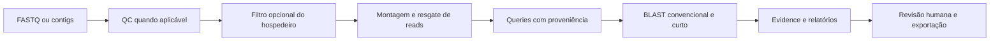

# Arquitetura e organização

O fluxo canônico usa QC, filtro opcional do hospedeiro, montagem ou resgate, busca por similaridade e exportação de candidatos. A interface e a CLI lançam os mesmos adaptadores de processamento.

| Diretório | Responsabilidade |
|---|---|
| `src/genein/` | CLI instalada, lote, estados e Evidence Graph |
| `scripts/pipeline/` | Preparação, QC, filtro, montagem, busca, coleta de queries e relatórios |
| `scripts/evidence/` | Agregação, competição, suporte, classificação e validação de artefatos |
| `scripts/dashboard/` | Servidor local, trabalhos, API e downloads |
| `dashboard/` | Interface, módulos JavaScript e assets locais |
| `scripts/lib/` | Validação de entradas e rotinas compartilhadas |
| `scripts/ops/` | Preparação de bancos, ambiente e operações |
| `config/` | Perfis, alvos e exemplos de configuração |
| `bundle/` | Instalação do ambiente científico e lançadores |
| `tests/`, `scripts/tests/` | Verificações de CLI, contratos e fluxo |
| `scripts/legacy/`, `scripts/experimental/` | Caminhos históricos e estudos explicitamente selecionados |
| `docs/` | Documentação da versão atual |

MULTI reúne sequências dos montadores e registra a origem de cada uma. Ele preserva contigs presentes em apenas um montador; não é consenso de bases. Reads curtos pós-QC/filtro podem ser consultados mesmo quando existem contigs longos. Comprimento de read, comprimento de sequência emitida e comprimento do HSP são unidades distintas.

Dados, bancos, ambientes, resultados, caches e evidências de execução são produzidos localmente e não integram a fonte no GitHub. `genein run` exige uma árvore de fonte completa e instalação editável: os adaptadores shell não são incluídos como executáveis independentes em um wheel Python.
